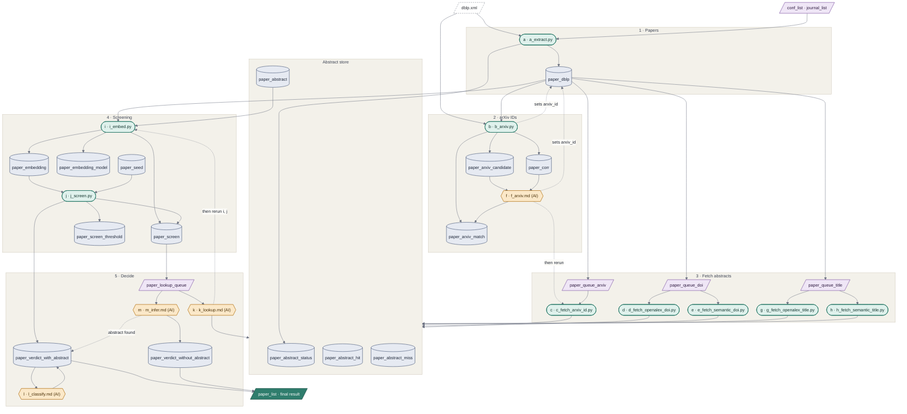

# 🏹 PaperHunter

All data lives in `archive/paperhunter.db`.

### 1. Environment

```bash
cp .env.example .env
```

### 2. Install

```bash
pip install lxml
```

### 3. Source data

Save to `archive/`:

- CORE conference ranking ([portal.core.edu.au/conf-ranks](http://portal.core.edu.au/conf-ranks/)) → `venue-core-2026.csv`
- Scopus CS journal ranking ([scimagojr.com](https://www.scimagojr.com/journalrank.php?category=1700)) → `venue-scopus-computer-science-journal-2025.csv`

### 4. Context

```bash
python3 circumstance/a_download.py
python3 circumstance/b_schema.py
```

**Output:** `archive/dblp.xml`, `archive/paperhunter.db` with every table and view

### 5. Conference list

```bash
python3 conference-hunter/a_extract.py
python3 conference-hunter/b_match.py
```

Give `conference-hunter/c_search.md` to the AI.

**Output:** view `conf_list`

### 6. Journal list

```bash
python3 journal-hunter/a_extract.py
python3 journal-hunter/b_match.py
```

Give `journal-hunter/c_search.md` to the AI.

**Output:** view `journal_list`

### 7. Papers

```bash
python3 paper-hunter/a_extract.py --from-year 2023 --to-year 2026
python3 paper-hunter/b_arxiv.py
python3 paper-hunter/c_fetch.py
```

Give `paper-hunter/d_arxiv.md` to the AI, then run `c_fetch.py` again.

```bash
python3 paper-hunter/e_embed.py
python3 paper-hunter/f_screen.py
```

Give `paper-hunter/g_lookup.md` to the AI, then run `e_embed.py` and `f_screen.py` again. Then give `paper-hunter/h_classify.md`, then `paper-hunter/i_infer.md`, then `h_classify.md` once more for the papers `i_infer.md` moved.

**Output:** view `paper_list`

#### Workflow diagram (proposed a→m design, not built yet)

Green = Python script, amber = AI prompt, blue = table, purple = view, dashed = input file or rerun.


