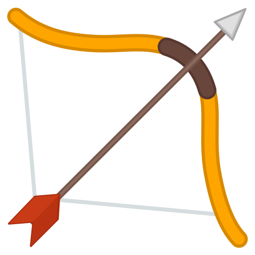

<p align="center">
  
</p>

# PaperHunter: Evidence-Grounded Research Paper Discovery and Categorization at Scale

All data lives in `b-config/paperhunter.db`.

### 1. Environment

```bash
cp .env.example .env
```

### 2. Install

```bash
python3 -m venv .venv
source .venv/bin/activate
pip install -r requirements.txt
```

### 3. Source data

Save to `b-config/`:

- CORE conference ranking ([portal.core.edu.au/conf-ranks](http://portal.core.edu.au/conf-ranks/)) → `venue-core-2026.csv`
- Scopus CS journal ranking ([scimagojr.com](https://www.scimagojr.com/journalrank.php?category=1700)) → `venue-scopus-computer-science-journal-2025.csv`

### 4. Context

Edit `b-config/semantic.json` (topic, queries, keywords, seeds) first.

```bash
python c-context/a_download.py
python c-context/b_schema.py
python c-context/c_threshold.py
```

**Output:** `d-download/dblp.xml`, `b-config/paperhunter.db` with every table and view, and `paper_semantic_threshold`

Run `c_threshold.py` again whenever `semantic.json` changes.

### 5. Conference list

```bash
python e-conference-hunter/a_extract.py
python e-conference-hunter/b_match.py
```

Give `e-conference-hunter/c_search.md` to the AI.

**Output:** view `conf_list`

### 6. Journal list

```bash
python f-journal-hunter/a_extract.py
python f-journal-hunter/b_match.py
```

Give `f-journal-hunter/c_search.md` to the AI.

**Output:** view `journal_list`

### 7. Papers

Every paper moves through status `A` → `G` in `paper_status`. Each step takes only papers at the previous status, so any step can be rerun safely and continues where it stopped.

```bash
python g-paper-hunter/a_extract.py --from-year 2023 --to-year 2026
python g-paper-hunter/b_arxiv.py
python g-paper-hunter/c_fetch.py
```

Give `g-paper-hunter/d_abstract.md` to the AI.

```bash
python g-paper-hunter/e_embed.py
python g-paper-hunter/f_semantic.py
```

Give `g-paper-hunter/g_search.md` to the AI.

**Output:** view `paper_list`
