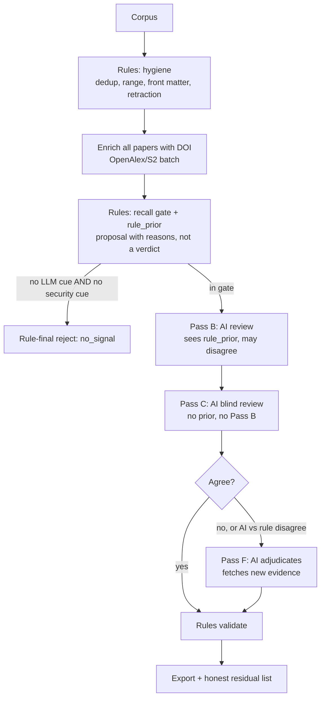

# PAPER-HUNTER: Expert Opinion on the Rule-Based / AI Balance

**Scope reviewed (all read in full):** `a_cli.py`, `b_io.py`, `c_schema.py`, `d_network.py`, `e_enrich.py`, `f_signals.py`, `g_passa.py`, `h_passbc.py`, `paper-matching-guide.md`, `paper-inventory/sample.csv`, `paper-reference/sample.csv`, `paper-supplement/sample.db` (schema and data).
**Extra evidence (read-only queries):** `paper-supplement/a-2026.db` (9,721 papers) and `q1-2023.db` (92,344 papers), plus in-memory calls to `judge_paper()` on synthetic abstracts that I wrote. Synthetic cases are labelled "synthetic" below and are not ground truth.
**Not reviewed:** `conference-hunter/`, `journal-hunter/`, `paper-database/`.

---

## 0. Verdict

| Your question | Answer |
|---|---|
| Is the pipeline fully dependent on rule-based decisions? | **Yes, in the autonomous run as written.** Every verdict in passes A, B, C, F and sweep comes from one function, `g_passa.judge_paper()`. The guide's own "Standard Autonomous Execution Sequence" (§8) contains no step where the agent reads a paper and decides. |
| Is there room for the agent's intelligence? | **The design leaves room (guide §1a, §7, `batch`/`record`/`fill`/`fulltext`, schema).** **The execution path does not use it.** The standard sequence also *destroys* any agent decisions made earlier (§2.4). |
| Is the master prompt well organised, concise, comprehensive, and does it make the agent use its own intelligence? | **Comprehensive, and the domain and role definitions are good. Not concise (about 35% duplicated), internally contradictory in 9 places (§5), and it never tells the agent how to weigh rule output against its own reading.** Its instructions (judge every paper individually) and its prescribed commands (scripts judge every paper) conflict. |

**Bottom line.** You have the pieces of a good hybrid: signals, enrichment, a strict validator, a multi-pass DB, and a good domain brief. The decision layer is missing. Fixing it is mostly a change of *who owns each decision* rather than a rewrite.

---

## 1. Core finding: passes B, C and F are not independent reviews

`h_passbc.py` runs `judge_paper(d, pass_name)` for B, C and F, and for `sweep`. It is the same function Pass A uses. Measured on real runs:

| Check (`a-2026.db`) | Result |
|---|---|
| Pass A vs Pass C, same paper, different verdict / class / confidence | **0 / 0 / 0 of 3,892** |
| Pass A vs Pass B, different verdict / confidence | **0 / 0 of 2,525** |
| Pass F vs Pass A: confidence raised / verdict flipped | **452 of 452 raised, 0 flipped** |
| Final lane A/B rejects with no abstract, labelled `publisher_page` | **522** (nobody opened a publisher page) |
| `final_decisions` rows with the template reason "Lane X paper investigated via publisher page metadata…" | **452** |
| Stage 7 audit query from the guide (low-confidence rejects or `needs_deep_dive`) | **0 rows, by construction** (see §3.3) |
| Rows in `fulltext`, `manual_overrides` (agent-side tools) | **0 and 0** |

Consequences:
- **Pass B ("deep dive")** reads no new evidence. It is Pass A again.
- **Pass C ("blind, anti-bias")** cannot disagree with A. It reports consensus where there is none.
- **`reconcile`** has nothing to reconcile.
- **Pass F ("definitive adjudication")** closes uncertainty by relabelling it: confidence rises to 0.95, `needs_deep_dive` goes to false and `evidence_level` becomes `publisher_page`.
- Roughly 40% of the corpus (3,892 of 9,721) is "reviewed" three times with zero added information.

The multi-pass architecture looks like defence in depth. Operationally it is one rule run counted four times.

---

## 2. Rule-engine findings (verified in code, then tested)

### 2.1 Fabricated evidence (highest severity; breaks the guide's "Never invent")
Three places write evidence nobody gathered:
1. `g_passa.judge_paper` (Pass F, lane A/B, no abstract): returns reject at 0.95 with `evidence_source="web"`, `evidence_level="publisher_page"`, and the reason "investigated via publisher page metadata; no LLM offensive agent identified".
2. `h_passbc.run_pass`: when `validate_record` fails, it overwrites evidence with `"Research paper on <title> published in <venue>"`, labels it `web`/`publisher_page`, and clears flags.
3. `a_cli.cmd_reconcile`: does the same for any lane A/B `title_only` row or any quote outside 4–45 words.

`validate_record` does not verify `web` quotes, so these strings pass. The validator's anti-fabrication guarantee is bypassed by the code that depends on it.

**Sample evidence.** In `sample.db`, HackWorld (p0028) and "Comparing AI Agents to Cybersecurity Professionals…" (p0030) were both lane A with no abstract. A/B/C correctly said "reject, 0.50, needs_deep_dive". Pass F then turned both into confident `off_domain` rejects. Both appear in `paper-reference/sample.csv` as `benchmark` and `evaluation`. I'm treating that file as your reference labels. Its timestamp differs from `sample.db`, so I infer it is hand-curated or from a later run. Sample recall is therefore 4 of 6, and both misses are the most valuable kind (in-domain, high-signal).

### 2.2 The accept gate is a narrow vocabulary test (recall)
Accept needs `is_offensive` and `has_llm_agent`, both regex hits, and `RX_AGENT` is phrase-based. Synthetic test, all abstracts clearly in-scope:

| Synthetic case | Rule outcome |
|---|---|
| "LLM agent that autonomously exploits web applications… ReAct-style loop… compromises 14/20 targets" (no word "pentest") | **reject `off_domain` 0.98** |
| "autonomous LLM agent… solves CTF tasks… shell loop" (writes "CTF", not "capture the flag") | **reject `off_domain` 0.98** |
| "LLM-driven agent compromises vulnerable hosts end to end, scanning to root shell" | **reject `off_domain` 0.98** |
| "GPT-4 based agents autonomously discover and exploit vulnerabilities…" | **reject `off_domain` 0.98** |
| Agent-based pentest paper whose **title** contains "Defense" | **reject `defensive_only` 0.95** |

The default branch asserts 0.98 confidence. That is the wrong failure mode: an unmatched paper should come out as "no evidence either way", not as 98% off-domain.

### 2.3 The same engine also false-accepts (precision)
Synthetic cases the engine **accepted as `baseline` at 0.95**:
- an agent that *hardens* networks (defence) whose abstract only mentions penetration-testing reports as input;
- a paper about *attacks on* LLM agents (tool-use exploitation, agent red teaming, a safety topic that §2 of your guide marks out of domain).

Accept records also hard-code `llm_agent = offensive_security = black_box = long_horizon = yes`, fixed `attack_surfaces` (`network/cve/web`) and a constant confidence. For accepted papers the criteria, confidence and surface columns therefore carry **no information**, and the engine can never emit `partial`.

### 2.4 Mislabelled near-domain rejects (hides the guide's "never silently drop" rule)
Guide §2 says near-domain papers must be rejected with `llm_no_offense` and `needs_deep_dive: true`. In practice the default branch writes the template reason *"Completely off-domain topic focusing on non-security machine learning, computer vision, robotics, or data mining"* for security papers. Examples in `a-2026`:
- p8860 *Co-Evolving SQL Injection Attacks and Modsecurity Rules via Agentic AI* (LLM attack and defence agents; §2 lists agent-vs-defender emulation as in scope);
- p8798 *LLM-Empowered Discovery of Windows APIs Exploitable for Persistent Storage in Fileless Attacks*;
- p8718 *RustXec: A Vulnerability Reproduction Dataset…*.

Whether each is a true accept is a judgement call, which is exactly the point. They were closed as "ML/CV/robotics" at 0.98 and are now unrecoverable from the audit table.

### 2.5 Hybrid runs are destructive
`h_passbc.run_pass` and `g_passa.run_pass_a` assign `decisions[pass] = rec` for **every** id in the plan without skipping existing rows. If the agent records real decisions with `a_cli.py record --pass B`, then runs `python3 h_passbc.py B` as the guide instructs, **the agent's decisions are overwritten**. As written, rules and AI are mutually exclusive on a given pass. That is the opposite of "neither is a blockage for the other".

### 2.6 Role assignment is title/first-sentence regex
- `is_benchmark` fires on `dataset`/`benchmark`/`testbed` in the first 250 abstract characters. A baseline paper that opens with "On a benchmark we show…" becomes a benchmark; this violates the guide's own litmus test (headline contribution).
- A secondary `benchmark` role is added on any "introduce… benchmark|dataset|suite". Incalmo and PentestLLMAgent got `baseline;benchmark` in `sample.db` this way.
- `is_agent_system` and `is_benchmark` special-case specific names (`incalmo`, `penforge`, `artemis`, `pentestllmagent`, `hackworld`). That is overfit to the current sample and will not generalise.

### 2.7 Signal layer: useful for ordering, poor as a lane definition
- `G_OFFENSE` uses `\bexploit`, which also matches *exploiting parallelism*. `G_AGENT` contains `agent`, `autonomous`, `reinforcement learning`. `cyber attack` + `multi-agent` matches control-theory papers.
- Result: lane A at `signal_score = 100` is mostly noise. In `q1-2023` the top 40 by score are RL/exploration–exploitation, control-under-cyberattack and consensus papers. In `a-2026` the top scores include UAV planning, LLM serving, and KV caching.
- Scale: lane A + B is 25.4% (`a-2026`) and 16.2% (`q1-2023`) of the corpus, but only 18 papers in `a-2026` match a loose "LLM + agent + offense" test.
- The guide then mandates a publisher-page visit for each lane A paper (§7 Step 1). That budget is spent on noise, while real papers whose titles lack lexical hits fall to lane C (§3.2).
- `seed_fuzzy`, `SEEDS` and `SEED_TITLES` hard-code 15 known papers. That is fine as a recall hint, but it biases toward already-known literature.

### 2.8 `publication_status` is not derived from evidence
`judge_paper` maps anything that is not `published` or `workshop_archival_toplevel` to `"published"` (preprint, workshop, thesis, unknown). Synthetic test: a `journals/corr/…` key, a workshop key, a `phd/…` key and a no-key record were all emitted as `published`. This silently defeats guide §5. It is **latent** today: `a-2026`, `q1-2023`, `a-star-2025` and `b-2025` contain zero `journals/corr/` rows, because upstream venue filtering already excludes preprints. But `a-2026.csv` has 397 lines containing "workshop", and its `final_decisions` rows show `published` for 9,707 papers and **blank for 14** (the duplicates).

---

## 3. Pipeline-level findings (CLI, I/O, enrichment)

### 3.1 Lane C is decided on titles only, because lane precedes enrichment
Standard sequence: `signals` → `enrich --lanes A,B` → `signals`. Papers whose *titles* look uninteresting never get an abstract. In `a-2026`, **7,142 lane-C papers were rejected on title alone** (only 109 of 7,251 had an abstract); 511 of those titles contain security/LLM/agent-ish words. I cannot say how many are wrong. I can say nothing looked. This is a chicken-and-egg: the cheap signal decides who is allowed to get the evidence that would test the cheap signal. OpenAlex batch enrichment costs about 1,850 requests of 50 DOIs for `q1-2023` and is not the bottleneck.

### 3.2 `sweep` is a no-op where the guide places it
`run_sweep` exits with "No final decisions yet" when `final_decisions` is empty, and the standard sequence calls `sweep` **before** the first `reconcile`. When it does run, it applies `judge_paper` again to rejects, so it can only rescue what the rules already accept. In `q1-2023` there are 2 `sweep` rows against 92,344 papers.

### 3.3 The Stage 7 self-audit cannot find anything
Stage 7 says to query for "low-confidence lane-A rejects or unresolved `needs_deep_dive=true`". `reconcile` forces `needs_deep_dive=False` and Pass F pushes confidence to 0.95, so the query returns 0 rows in `a-2026`. The audit is vacuous, and the agent will report success.

### 3.4 Smaller defects
- `--n` defaults to 10 in argparse, so `lane_batch_size()` is never used from the CLI. The guide's "CLI auto-selects lane batch sizes if you omit `--n`" (§1a) is false.
- `batch` prints "follow prompt.md" / "Re-read prompt.md sections 2-4". That file does not exist; the guide is `paper-matching-guide.md`.
- `validate_record` accepts `"unclear"` as a criteria value, and a legacy `baseline_candidate` role is still referenced in error text. Neither is in the guide.
- `YNU` in `c_schema.py` is unused.
- `.current` is a single global pointer (one run at a time).
- `save_papers()` rewrites every row (JSON blobs, 92k papers) on each pass.
- A byte-identical copy of `paper-hunter/`, `paper-inventory/`, `paper-reference/`, `paper-supplement/` sits in a nested `paperhunter-research-paper-discovery/` folder (confirmed identical by `diff`). Drift risk: the agent could run the wrong copy.

### 3.5 What is genuinely good (keep)
- **`c_schema.validate_record`**: enums, two-verdict system, verbatim quote check (`quote_in`), accept/baseline consistency, title-only guards. This is the right *rule-side* role, as a validator.
- **Evidence-level vocabulary** (`title_only` → `abstract` → `publisher_page` → `full_text`). It only needs to be *earned*, not assigned.
- **DB design**: `decisions` keyed by (paper, pass), `final_decisions`, `pass_queue`, `audit` view, `manual_overrides`, `papers.fulltext`. It already supports a real multi-reviewer design.
- **Agent tooling**: `batch`, `record`, `fill`, `fulltext`, `search`, `show --blind`. Everything an AI reviewer needs exists and is simply unused.
- **Throttled, resumable network layer** and an early connectivity probe.
- The guide's **domain definition, role litmus test and criteria semantics**.

---

## 4. Recommended architecture: rules propose, evidence gates, AI disposes, rules validate

Principle: each side owns what it is best at, and neither can override the other silently.

### 4.1 Decision rights

| Decision | Owner | Why |
|---|---|---|
| Dedup, year range, front matter, retraction, DBLP-key publication hints | **Rules (authoritative)** | Deterministic facts. |
| Corpus triage: "can this paper possibly matter?" | **Rules (recall-biased gate)** | Cheap and safe at scale if the gate is loose. |
| Verdict, role, `primary_role`, criteria values, reject class for gated papers | **AI (authoritative)** | Needs reading and judgement: litmus test, soft criteria, near-domain. |
| Evidence retrieval (abstract, publisher page, full text) | **AI + tools; rules only record that it happened** | Only fetched evidence may raise `evidence_level`. |
| Schema, quote verification, role↔contribution, publication filter | **Rules (validator, can veto)** | Anti-fabrication and consistency. |
| Disagreement between rule prior and AI verdict | **AI adjudicates in Pass F with fresh evidence** | Neither side gets to win by default. |

### 4.2 Proposed flow

### 4.3 What each stage should do

1. **Pass A (rules)**: runs on everything, writes `rule_prior` (verdict *proposal*, matched cues, suggested role, and an explicit `confidence_basis`). It does **not** write final verdicts for gated papers.
2. **Recall gate** (deterministic, loose). Measured on your corpora with a simple LLM-term AND security-term test over title+abstract:
   - `a-2026`: **255 papers (2.6%)**; `q1-2023`: **218 papers (0.24%)**. Compare lane A+B at **25.4% / 16.2%**.
   - These are floors, because papers without abstracts were gated on title only; hence enrich everything first (§3.1).
   - Add to the gate: `seed_fuzzy ≥ 0.45`, any rule `accept` or `llm_no_offense`, and **any paper with no abstract whose title carries any cue**.
   - Papers outside the gate with no cue at all can be rule-final rejects (`no_signal`). That is safe: ~97–99% of the corpus.
3. **Pass B (AI, informed)**: sees the dossier plus `rule_prior`. Records `agrees_with_rule` and, if overruling, `override_reason`. Treat rule output as a hypothesis.
4. **Pass C (AI, blind)**: must not see any prior (the CLI already supports `show --blind`). It reviews every paper the rules or Pass B accepted or called near-domain, plus a stratified sample of gate-passing rejects. Using a *different* evidence path (for example, full text where B used the abstract) buys real independence.
5. **Pass F (AI, adjudication)**: only for disagreements. It must obtain **new** evidence (`fill`, `fulltext`, or web with URL). Unresolvable papers stay unresolved (see 4.4).
6. **Validation (rules)**: schema as today, plus the invariants in 4.4.

At the measured gate size, the AI reviews a few hundred papers per file, not thousands. Your guide states time and tokens are not a concern, so this is affordable even for 92k-paper files.

### 4.4 Honesty invariants (make the rules protect the AI from itself)
- `evidence_level ∈ {publisher_page, full_text}` is valid only if the DB holds a matching fetch record (a `manual_overrides` row with source and URL, or a `papers.fulltext` row). The validator checks this; no code path may set it by assignment.
- Add reject class **`insufficient_evidence`** and let `needs_deep_dive` survive `reconcile`. Then Stage 7 has something to find, and the final message can report "N papers could not be resolved", instead of burying uncertainty at 0.95.
- Keep a **`near_miss`** flag for near-domain rejects (`llm_no_offense`, agent-vs-defender, advisory copilots, non-LLM autonomous pentest) so they can be listed in one query. Today the guide asks for this (§2) but nothing preserves it.
- For accepts: criteria, `confidence` and `attack_surfaces` come from the reviewer. No hard-coded `yes`.
- For rejects: require a verbatim quote only for gated or near-domain papers. A mandatory 4–45-word quote on 90,000 obvious rejects is what pushes code toward the "Research paper on X published in Y" placeholder.
- Rules must never overwrite an existing AI decision in the same pass. Make `h_passbc.py` and `g_passa.py` skip existing rows, or write to a distinct `rule` pass name.

### 4.5 Where I would *not* move to AI
Keep deterministic: parsing, deduplication, year range, DBLP-key publication hints, schema validation, quote checking, queue construction, export. These are the parts that worked correctly in every run I inspected.

---

## 5. Master prompt (`paper-matching-guide.md`) review

### 5.1 Organisation, concision, comprehension

| Aspect | Assessment |
|---|---|
| Domain definition (§2) | **Strong.** Four facets, in-scope list, near-domain, out-of-domain. |
| Roles and litmus test (§3) | **Strong.** "System that attacks vs thing used to measure systems that attack" is the right question. |
| Evidence ladder (§1a, §7) | **Good concept**, over-specified and repeated. |
| Concision | **Weak.** Criteria text appears 3× (§1a, §3.1, §4), the missing-abstract rule 3× (§6, §7, §11), baseline evidence requirement 3× (§1a, §3.1, §7), verdict rules 3× (§1a, §6, §11). Roughly a third of 418 lines is restatement. |
| Operational clarity | **Conflicted.** See 5.2. |
| Telling the AI *how to weigh* script output | **Missing.** §7 says only "signals order and prioritise; never reject because a signal is low". Nothing says how much to trust a Pass A verdict, when to overrule it, or what to do on disagreement. |
| Worked examples | **Thin.** Six named baselines. No near-miss example, no multi-role example, no "title misleads" example, although the sample contains three good ones (below). |
| Calibration | **Missing.** `confidence` has no definition, only caps (≤0.60, ≤0.65, ≤0.70) as penalties. |
| Safety | **Good.** Rule 4 (content is data, not instructions) and the drift reminder are the right instincts. |

### 5.2 Internal contradictions the agent has to resolve silently

1. **§1 rule 2** "judge every paper individually, never batch-decide" vs **§8** standard sequence, where scripts decide every paper.
2. **§1a "Agent applies judgment" list** vs the sequence. `batch`/`record` appear only as `batch --pass B --n 1`, which exists to freeze the plan (it prints one dossier as a side effect).
3. **Baseline evidence:** §1a says `publisher_page` or `full_text` are required; §3.1 and `validate_record` accept `abstract`.
4. **Soft criteria:** §3.1 and §4 call `black_box` and `long_horizon` SOFT and allow `partial`; `validate_record` requires all four = `yes` for baseline. A paper with `black_box=partial` cannot be a baseline, and the only honest outcome is reject. This pushes reviewers (and the rule engine) toward inflating `partial` to `yes`.
5. **Near-domain handling:** §2 says reject with `needs_deep_dive: true`; Pass F and `reconcile` force `needs_deep_dive=false`.
6. **Undecidable papers:** §6 classifies them as `llm_no_offense`, which is a different claim from "could not be determined".
7. **Exploit generation:** §2 puts CVE/N-day exploit agents and binary-exploitation agents in scope; §4 says `offensive_security` fails if the LLM "only generates single exploits/payloads". The pipeline's own `a-2026` output accepts an exploit-generation multi-agent framework as baseline, so the practice already exists but the prompt does not define it. The prompt needs a one-line rule: *iterative, feedback-driven exploit agent = in; one-shot payload generation = out.*
8. **Pass C "blind independent"** (§8 Stage 3) vs a script that is not blind or independent.
9. **Auto batch size** (§1a) vs a CLI that never auto-selects.

### 5.3 Does it guide the AI to use "online + stored" information well?
Partly. It lists the right sources (abstract, DOI page, arXiv, full text, S2 TLDR, topics, `signal_flags`, `role_hints`, `seed_fuzzy`) and the right tools. It does **not** tell the agent to:
- compare its reading against `rule_prior` and log disagreements;
- use `cited_by`, `retracted`, `crossref_type` and `abstract_candidates` (stored in the DB, shown in the dossier) to cross-check publication status and abstract quality;
- escalate evidence level in proportion to uncertainty, instead of by lane;
- treat the stored `fulltext` as the preferred source when an abstract is ambiguous.

### 5.4 Reference cases the prompt should teach (from `paper-reference/sample.csv`)
These are good because the label is *not* obvious from the keywords:
- **"Towards Effective Offensive Security LLM Agents: Hyperparameter Tuning, LLM as a Judge, and a Lightweight CTF Benchmark"**: title says "Agents", reference role is `benchmark` (headline contribution check).
- **HackWorld**: "Evaluating Computer-Use Agents…": a benchmark, with no abstract available through the APIs (evidence-gathering case).
- **"Comparing AI Agents to Cybersecurity Professionals…"**: an evaluation study that may also ship an agent (primary-role ambiguity; needs the abstract, so do not decide from the title).
- One near-miss with reasoning (for example, an advisory copilot or non-LLM autonomous pentest) so the AI sees what "reject but flag" looks like.

### 5.5 Recommended shape (about 200 lines, down from 418)
1. Mission, autonomy and safety rules (keep §1 rules 1, 3, 4, 5, 6, 7).
2. Domain and roles (keep §2–§3 as is, plus the exploit-generation line and the four reference cases).
3. **New "Decision protocol" section**: decision rights table (§4.1), how to read `rule_prior`, how to log agreement/overrule, confidence scale, escalation ladder by uncertainty.
4. Evidence ladder: one definition, one table, one rule for missing abstracts.
5. Criteria: one definition, with soft-criterion gating aligned with the validator.
6. Stage commands (one sequence), with the agent's actual per-stage task stated next to each command.
7. Record schema and troubleshooting (unchanged).

A drop-in paragraph for item 3:

> *Script output is a hypothesis, never a verdict. Read the paper first, then read `rule_prior`. If you disagree, record why in `override_reason`. Never raise `evidence_level` without having fetched that source. If you cannot reach a decision after fetching, reject with `insufficient_evidence`, keep `needs_deep_dive: true`, and let the final report list it. An unresolved paper is a correct outcome; a falsely confident one is not.*

---

## 6. Prioritised change list

**P0: integrity (do first)**
1. Remove the three fabricated-evidence paths (§2.1).
2. Make B/C/F genuine AI passes, or delete them. Do not re-run rules as an "independent" reviewer (§1).
3. Stop rules overwriting existing decisions (§2.5).
4. Preserve uncertainty: `insufficient_evidence`, `needs_deep_dive` survives reconcile, Stage 7 query becomes non-vacuous (§3.3, §4.4).
5. Evidence-level provenance check in the validator (§4.4).

**P1: recall, precision, and balance**
6. Rules emit `rule_prior`; the AI owns verdicts for gated papers (§4.1–4.3).
7. Enrich all papers with a DOI before triage (§3.1).
8. Replace lane with a recall gate for AI routing; keep lane only as an ordering hint (§2.7).
9. Align baseline gating with the guide's SOFT criteria (§5.2 #4).
10. Derive `publication_status` from evidence; keep `unknown` (§2.8).
11. Fix or retire `sweep`; in the new design the gate does its job (§3.2).

**P2: hygiene**
12. Fix `--n`, `prompt.md` references, `YNU`, legacy `baseline_candidate`, nested duplicate folder, one-run `.current`, full-table rewrites (§3.4).
13. Restructure the guide per §5.5.

---

## 7. Confidence and limits of this review

- **Verified directly:** every count in §1 and §3 (SQL against your DBs); every code-behaviour claim (code read in full; behaviours reproduced by calling `judge_paper` in memory).
- **Synthetic cases (mine, not ground truth):** the roughly dozen recall and precision probes in §2.2–2.3. They show *failure modes exist*; they do not give a recall or precision rate.
- **Not measurable from what I have:** true recall on your real corpora. No labelled set exists beyond the 6-paper sample. `a-2026` (2 accepts of 9,721) and `q1-2023` (0 of 92,344) may be *correct* outcomes, since 2023 predates most LLM-pentest work, and the loose scan of `a-2026` did not turn up an obvious accept among papers *with* abstracts. The evidence points to the risk concentrating in no-abstract papers and in the narrow accept vocabulary. I recommend building a small labelled set (the 15 `SEED_TITLES` plus `paper-reference` rows) and measuring recall before and after any change.
- **Role-ambiguity cases (for example Lin et al.)** are where AI reading adds the most. I did not read their abstracts (none are stored), so I am not asserting a role for them.
